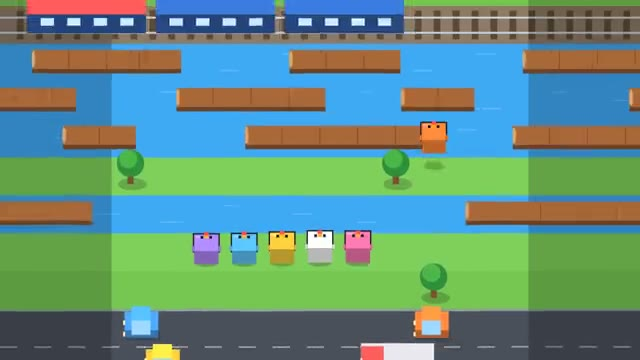

# Road Hop

Hop the traffic. Don't fall behind. Last one hops. A multiplayer starter game from [Multiplayer Agent](https://multiplayeragent.com): 2D, versus, 2–12 players, with bots that fill empty seats.

## How it plays

Everyone hops across the same endless roads, rivers and train tracks. Ride the logs, time the cars, and watch for the flashing train light. The roller follows the leader and squishes anyone left behind. Last one hopping wins the round.

**Controls:** Arrow keys or WASD to hop, or tap to hop forward and swipe to hop any way.

## Make it yours in the Game Builder

Open the [Game Builder](https://multiplayeragent.com), choose **Start from a starter game** and pick Road Hop. It opens as version 1 in your studio, ready to play and publish. Then ask for changes, for example:

- Add coins on the grass that you can collect
- Make it a winter world with ice and snowplows
- Let players pick an animal before the round starts

## Run it yourself

1. Get a free publishable key (`pk_…`) at [multiplayeragent.com](https://multiplayeragent.com).
2. In `index.html`, put it in place of `pk_REPLACE_ME` in the `MP_CONNECT` block.
3. Open `index.html` in a browser. No build step and no server needed.

Without a key it still runs, offline against bots.

## How it is built

- One `index.html`. The comment at the top of the script maps the code and explains the multiplayer.
- **Leaderboard:** Each player's farthest hop in one round, shown after every round.
- **Host-run rounds:** The host's browser starts each round with a new world seed, sees who is out and calls the winner; if it leaves, the next player takes over.
- **Bots:** Bots fill the empty seats: they look ahead, wait for gaps and ride the logs, and now and then hop without looking.
- **Live sync:** Everyone builds the same world from one seed and a shared clock, so every car and log is in the same place on every screen.
- `?attract` runs it offline with bots only. The preview video is recorded from it.

## License

MIT.
